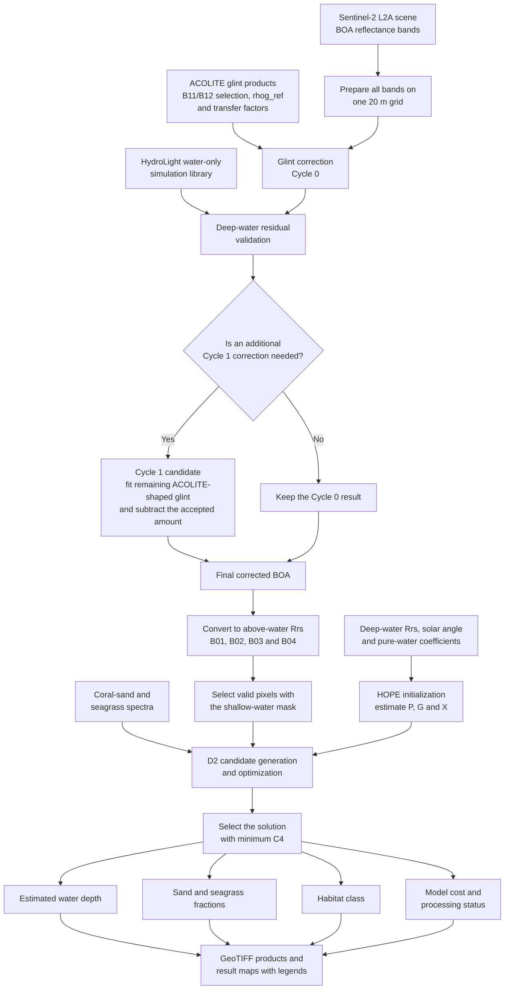

# 2026 PCIS Project

Satellite imagery inventory, glint correction, and semi-analytical shallow-water modelling for the Pacific Island project.

## End-to-end workflow

Follow the diagram from the satellite inputs to the final depth and habitat
products. The sections below the diagram explain each stage in the same order.

## Processing stages

### 1. Satellite and supporting inputs

The workflow begins with Sentinel-2 L2A bottom-of-atmosphere reflectance. The
supporting inputs are the ACOLITE glint products, HydroLight water-only spectra,
a shallow-water mask, pure-water optical coefficients, and coral-sand and
seagrass spectra.

### 2. ACOLITE glint correction: Cycle 0

The Sentinel-2 bands are aligned on one 20 m grid. ACOLITE provides the B11/B12
selection, `rhog_ref`, and band-transfer factors. These values estimate the
surface-glint contribution in every optical band. Subtracting that estimate from
the original BOA reflectance produces Cycle 0.

### 3. HydroLight validation and the Cycle 1 decision

HydroLight spectra represent plausible water-only signals. The workflow
compares them with deep-water Cycle-0 spectra to test whether an
ACOLITE-shaped residual remains. Cycle 1 fits that residual to the original
ACOLITE glint spectral shape and subtracts only a detected, spatially coherent
component. It is a conditional Python calculation rather than another ACOLITE
run. The result is retained only when every validation gate passes.

The included scene did not pass the Cycle 1 scene gate. Its final
glint-corrected product therefore remains Cycle 0.

### 4. HOPE water-column initialization

**HOPE** means **Hyperspectral Optimization Process Exemplar**. It is a
physics-based semi-analytical method introduced by Lee and co-authors. Here,
HOPE fits the deep-water spectrum and estimates `P` for phytoplankton
absorption, `G` for dissolved and detrital absorption, and `X` for particle
backscattering. These parameters describe the water column for the next stage.

### 5. D2 shallow-water inversion

**D2** is the configuration label used in the supplied code for the Lee
shallow-water forward model. It predicts the water-column and bottom
contributions to the measured reflectance. The inversion changes water depth
and the sand–seagrass mixture until the modeled four-band reflectance best
matches Sentinel-2. `D2` is a model label in this implementation, not a separate
acronym.

### 6. Final outputs

The solution with the lowest four-band spectral mismatch (`C4`) supplies the
estimated depth, sand fraction, seagrass fraction, habitat class, model cost,
and processing status. The workflow exports these products as GeoTIFF files and
maps with legends.

## HTML files

The links below open the files on GitHub. To use them as interactive pages, download the repository ZIP, extract it, and open `index.html` locally.

- [Satellite inventory](inventory.html) — browse Sentinel-2 and Planet Dove scenes.
- [ACOLITE glint correction](glint_correction.html) — method and interactive scene comparison.
- [Semi-analytical concept](semi_analytical_concept.html) — model workflow and output interpretation.
- [Semi-analytical results map](semi_analytical_map.html) — explore Sentinel-2 depth and habitat products geographically.

## Open the interactive pages

Download this repository as a ZIP, extract the whole folder, and open `index.html` in a browser. Keep the asset folders beside the HTML files. The results map uses an online basemap; the project overlays are stored in the repository.

The Python code is included in the `semi_analytical/` and `glint_correction/` folders.

The glint package is arranged in execution order. Start with
[`glint_correction/00_READ_ME_FIRST/01_WORKFLOW_ORDER.md`](glint_correction/00_READ_ME_FIRST/01_WORKFLOW_ORDER.md),
then inspect the numbered input, runner, reference output, generated output,
and complete source-code folders.
