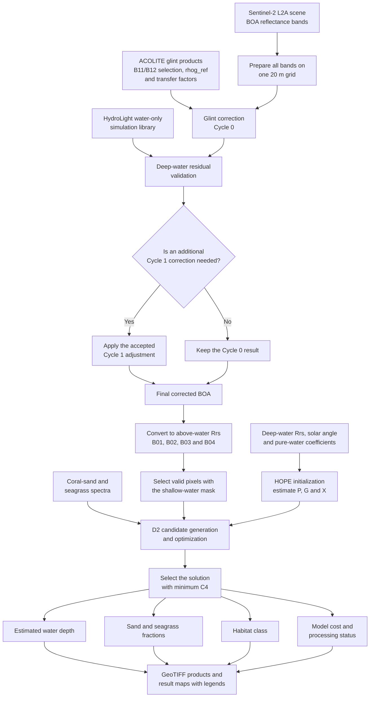

# 2026 PCIS Project

Satellite imagery inventory, glint correction, and semi-analytical shallow-water modelling for the Pacific Island project.

## End-to-end workflow

The processing begins with one Sentinel-2 scene. The glint-correction stage
removes estimated surface reflection and produces corrected water reflectance.
The semi-analytical stage then uses that corrected reflectance to estimate water
depth and the relative contributions of coral sand and seagrass.

### What HOPE and D2 mean

- **HOPE** means **Hyperspectral Optimization Process Exemplar**. It is a
  physics-based semi-analytical method introduced by Lee and co-authors. In this
  project, the HOPE equations fit the deep-water spectrum and estimate three
  water optical parameters: `P` for phytoplankton absorption, `G` for dissolved
  and detrital absorption, and `X` for particle backscattering.
- **D2** is the configuration label used in the supplied code for the Lee
  shallow-water forward model. It predicts how much of the measured signal
  comes from the water column and how much comes from the bottom after
  attenuation through the water. The inversion changes depth and the
  sand–seagrass mixture until the modeled four-band reflectance best matches
  Sentinel-2. `D2` is a model label in this implementation, not a separate
  acronym.

## HTML files

The links below open the files on GitHub. To use them as interactive pages, download the repository ZIP, extract it, and open `index.html` locally.

- [Satellite inventory](inventory.html) — browse Sentinel-2 and Planet Dove scenes.
- [ACOLITE glint correction](glint_correction.html) — method and interactive scene comparison.
- [Semi-analytical concept](semi_analytical_concept.html) — model workflow and output interpretation.
- [Semi-analytical results map](semi_analytical_map.html) — explore Sentinel-2 depth and habitat products geographically.

## Open the interactive pages

Download this repository as a ZIP, extract the whole folder, and open `index.html` in a browser. Keep the asset folders beside the HTML files. The results map uses an online basemap; the project overlays are stored in the repository.

The Python code is included in the `semi_analytical/` and `glint_correction/` folders.

The glint package is arranged in execution order. Start with
[`glint_correction/00_READ_ME_FIRST/01_WORKFLOW_ORDER.md`](glint_correction/00_READ_ME_FIRST/01_WORKFLOW_ORDER.md),
then inspect the numbered input, runner, reference output, generated output,
and complete source-code folders.
