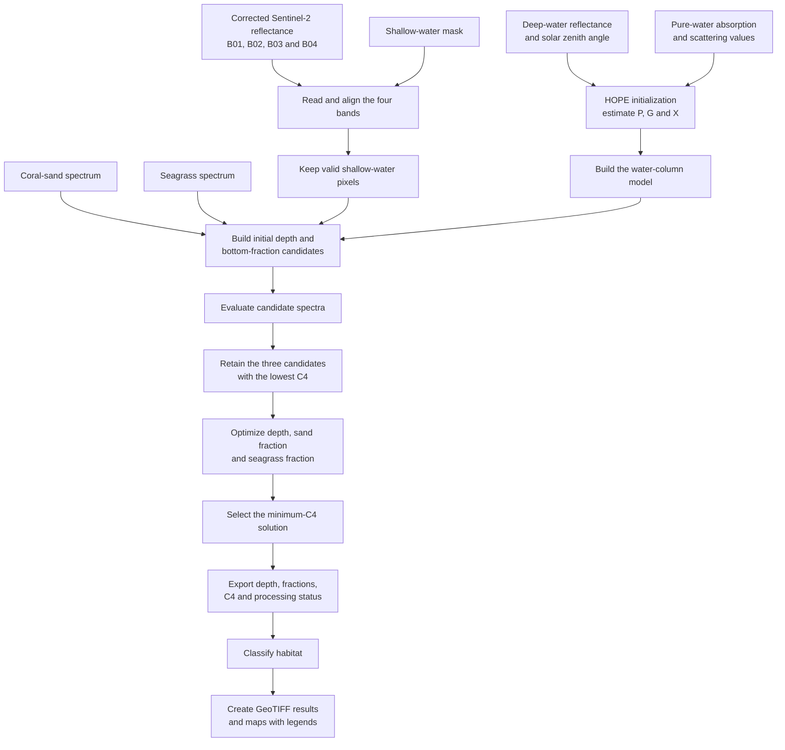

# One-scene semi-analytical workflow

## What this workflow does

This workflow estimates shallow-water depth and bottom composition from one
Sentinel-2A image. It uses the corrected satellite reflectance in four visible
bands, optical properties of pure seawater, and reference spectra for coral
sand and seagrass. For every valid shallow-water pixel, the model searches for
the combination of water depth, sand fraction, and seagrass fraction that best
reproduces the satellite observation.

The workflow has two connected model stages:

- **HOPE water-column initialization:** estimates the deep-water optical
  parameters `P`, `G`, and `X` from the scene's deep-water reflectance.
- **D2 shallow-water inversion:** combines those water-column properties with
  sand and seagrass spectra, tests candidate solutions, and selects the solution
  with the smallest spectral mismatch (`C4`).

The final products are estimated water depth, sand fraction, seagrass fraction,
habitat class, model cost, and processing status. The package contains the input
values, Python code, and step-by-step outputs needed to reproduce the included
one-scene example.

## Workflow diagram



```text
Scene: 20260808_S2A
Bands: B01, B02, B03 and B04 above-water Rrs
Grid: EPSG:32748, 20 m
Bottom components: coral sand and seagrass
```

## Folder structure

```text
semi_analytical/
├── README.md
├── code/
│   ├── run_one_scene.py
│   ├── render_step_results.py
│   ├── RUN_ME_WINDOWS.bat
│   ├── requirements.txt
│   ├── model and optimizer modules
│   └── input_values/
│       ├── scene_20260808_S2A/
│       ├── reference_data/
│       └── hydrolight_reference/
└── results_step_by_step/
    └── 20260808_S2A/
```

All Python comments and docstrings in this portable folder are in English.

## Inputs included

### Satellite values

- Corrected above-water `Rrs` rasters for Sentinel-2 B01, B02, B03 and B04.
- One shallow-water processing mask.
- One deep-water spectrum and solar zenith angle used to estimate the water-column optical properties.

### Optical reference values

- `H2OabDefaults_SEAwater.txt`: pure seawater absorption and scattering coefficients.
- `coral_sand.txt`: coral-sand bottom reflectance spectrum.
- `avg_seagrass.txt`: average seagrass bottom reflectance spectrum.
- `model_library_B02_B8A.csv`: the 675-spectrum HydroLight reference library. It is included for traceability; the HOPE/D2 inversion itself uses the four-band deep-water fit and the pure-water coefficients.

## Workflow

1. Read the four corrected Sentinel-2 `Rrs` bands and the shallow-water mask.
2. Read the pure-water absorption and scattering coefficients at 443, 490, 560 and 665 nm.
3. Fit the deep-water HOPE parameters `P`, `G` and `X` from the included deep-water spectrum.
4. Interpolate the sand and seagrass spectra to the four working wavelengths.
5. Build the initial depth and bottom-fraction seeds.
6. Retain the three lowest-C4 seeds and optimize each with fixed 0.1 m depth and 0.01 fraction increments.
7. Select the minimum-C4 solution for every valid shallow-water pixel.
8. Export depth, sand fraction, seagrass fraction, C4, processing status and habitat class.
9. Render the four-panel result map with legends.

The raw fractions are retained. Values below 0 or above 1 are marked uncertain in the habitat product rather than clipped.

## Run on another computer

Install Python 3.10 or newer. From the `code` folder:

```powershell
python -m pip install -r requirements.txt
python run_one_scene.py
python render_step_results.py
```

On Windows, `RUN_ME_WINDOWS.bat` performs the same steps.

The outputs are written to `results_step_by_step/20260808_S2A`.

## Step-by-step results

The result folder contains:

1. `01_deep_water_initialization.json` — wavelengths, deep-water Rrs, pure-water values and fitted P/G/X.
2. `02_model_and_search_settings.json` — forward-model and optimizer settings.
3. `03_processing_summary.json` — mask, valid-pixel, success and failure counts.
4. `20260808_S2A_C4.tif` and `20260808_S2A_status.tif` — optimization cost and processing state.
5. `20260808_S2A_depth_m.tif` — estimated water depth.
6. `20260808_S2A_sand_fraction.tif` and `20260808_S2A_seagrass_fraction.tif` — bottom fractions.
7. `20260808_S2A_habitat.tif` — sand, seagrass, mixed and uncertain classes.
8. `20260808_S2A_pilot_maps_with_legends.png` — combined visual result with legends.

`pilot_metadata.json` preserves all run values, and `failures.json` records any pixel-level failures.
